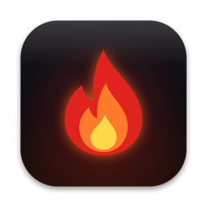

<h1 align="center">Fire Ring</h1>

Your AI coding agents, in the Mac notch. See at a glance which task needs you, which is still running, and which is done.

Works with Claude Code · Codex · DeepSeek Harness　|　<a href="README.md">中文</a>

---

## Three states

| State | Mark | Meaning |
| --- | --- | --- |
| Needs you | Red flame | The agent asked a question, wants a plan approved, or is waiting for permission |
| Running | Blue flame (flickers) | Working right now, background tasks included |
| Done | Green check | This turn has finished; open it in its own app and it clears itself |

## What it does

- **Notch alerts**: when a task finishes or needs you, the notch drops down for 3, 6 or 10 seconds. Point at it to see every task; click one to jump straight back to that conversation. “Clear all” burns finished tasks away in a shower of sparks, with a crackle of fire. The notch steps aside in full-screen apps.
- **Sounds and notifications**: a sound and a system notification when a task needs you or finishes, from original sounds or the macOS ones; a reminder if you have not responded, pause and per-tool switches, and a one-time alert when Codex usage or the DeepSeek balance runs low. “Try it” in Settings plays the whole thing.
- **Menu-bar panel**: click the three-layer flame to see tasks by Needs you / Running / Done, and click any task to open its app and conversation. Right-click the flame to pause alerts, open Settings or quit.
- **Limits and balance**: what is left of Codex’s 5-hour and weekly limits; your DeepSeek balance, today’s spending and a 24-hour balance curve; an optional reminder of when a used-up Claude limit resets. Choose whose limits to show in Settings.
- **Connect what you use**: Claude Code, Codex and DeepSeek Harness connect one by one; using just one is fine. A tool you have not connected is never read and never shown.
- **Light and dark**: pick Dark (default), Light or Match system in Settings. The notch itself always stays black.
- **Open at login**: asked once during setup: Allow, Don’t allow, or Don’t ask again.

## Install

Needs macOS 14 or later on Apple silicon (M-series).

1. Download the latest `FireRing-version-arm64.dmg` from [Releases](../../releases).
2. Open the dmg and drag Fire Ring into Applications.
3. First open: Fire Ring is not yet signed with an Apple developer certificate, so macOS says it cannot verify the developer. Open System Settings → Privacy & Security and click “Open Anyway” near the bottom. Only once.
4. A handwritten “fire” greets you on first launch. Then connect the tools you use under Connections, and you are done.

## DeepSeek balance (optional)

DeepSeek bills per token, so Fire Ring shows your account balance. It needs your own API key:

1. Open the [DeepSeek platform](https://platform.deepseek.com/api_keys) and sign in with the same account as DeepSeek Harness.
2. Under “API keys”, create a key (any name, such as Fire Ring).
3. Copy the key starting with `sk-`; it is shown only once.
4. Paste it under Fire Ring Settings → Connections → DeepSeek balance, and save.

The key stays only in your Mac’s keychain, is used only to check the balance (every 10 minutes), and is never shown or logged.

## Privacy and network

- Task titles and states are read from the records each tool keeps on your Mac and shown only there. No conversation content is uploaded.
- Online for three things only: checking the DeepSeek balance (only with a key and with it shown), checking for updates, and downloading them.
- Choose the route under Settings → Network: follow the system proxy, set one HTTP proxy, connect directly, or go fully offline.
- Checks for a new version every 6 hours; downloads are verified before Fire Ring replaces itself and restarts, keeping your settings.

## Questions

**Does it use my tokens?**
No. Fire Ring only reads records on your Mac and never calls a model. The DeepSeek balance check is an account query: no tokens, no charge.

**Why no Claude usage percentages?**
The Claude desktop app keeps no live usage data on your Mac, and Fire Ring will not borrow your sign-in to ask for it. So it only reminds you when a used-up limit resets, and that is off by default.

**Intel Macs?**
Apple silicon only for now.

**How do I uninstall it?**
Quit Fire Ring from Settings and delete it from Applications. If you connected DeepSeek Harness, click “Disconnect” in Settings first to remove its plugin too.

---

Fire Ring is not open source; this repository only holds its introduction and installers. See [LICENSE](LICENSE) for the copyright notice and [THIRD-PARTY.md](THIRD-PARTY.md) for third-party components bundled in the installer.
